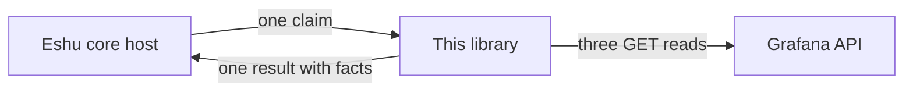

# eshu-collector-grafana

Status: pre-release library plus a satellite image. It's not the live Grafana producer for Eshu yet.

This repo is a Go library, plain and simple. It reads live Grafana metadata and hands Eshu small checked records (we call them facts) that Eshu can store as evidence. A host inside Eshu core imports the packages, passes in one bounded work request (a claim), and gets one result back. The same wiring also ships as a runnable image: `cmd/collector` reads one claim from stdin and writes one result to stdout, so the extension host can run it without importing the module. The image keeps no schedule and serves one claim per run, exactly like the library.



Same picture in words: the host gives this library a claim, the library asks Grafana what it has, and the host receives facts to store. Nothing here runs on its own schedule.

## Should you reach for this?

Reach for it if you're building or testing the Eshu host path that tracks live dashboards, folders, datasources, and alert rules. It answers questions like "what dashboards does that Grafana actually serve right now?"

Skip it if you want a standalone exporter, a dashboard backup tool, or anything that writes to Grafana. The library can't run without a host and the image can't run without a claim on stdin; neither keeps a schedule. Both never write to Grafana, and both deliberately ignore dashboard JSON, datasource URLs, and credentials. Those never belong in a fact.

One design point to carry with you: the host must deliver the core-issued producer grant with each claim. Without a usable grant the satellite ends the claim with zero facts instead of unauthenticated evidence, so an unwired host collects nothing. See `grant.example.json` for the request shape an operator submits to core.

## The shortest way in

Add it to your host module and call it once per claim:

```bash
go get github.com/eshu-hq/eshu-collector-grafana
```

```go
import (
    "github.com/eshu-hq/eshu-collector-grafana/grafana"
    "github.com/eshu-hq/eshu-collector-grafana/grant"
)
```

You build a source with `grafana.NewClaimedSource`, then call `Collect(ctx, claim, grant)` for each claim. If the grant is missing or wrong, the call fails before anything talks to Grafana, which is exactly what you want. Full field-by-field notes live in [the configuration reference](docs/reference/configuration.md), and the wiring walkthrough in [the usage guide](docs/guides/usage.md).

## A quick tour of the docs

| Start here when… | Read |
| --- | --- |
| you want to know how a claim becomes facts | [docs/architecture](docs/architecture/README.md) |
| you're wiring the library into a host | [the usage guide](docs/guides/usage.md) |
| you're about to push a change | [docs/contributing](docs/contributing/README.md) |
| you want the full map | [docs/README.md](docs/README.md) |
| you learn from pictures | [docs/diagrams](docs/diagrams/README.md) |

Package comments in `grafana/doc.go` and `grant/grant.go` are worth a look too. They're short.

## Neighbors worth knowing

- [eshu](https://github.com/eshu-hq/eshu): core, plus the host that will import this library and own admission, storage, and claims.
- [eshu-sdk](https://github.com/eshu-hq/eshu-sdk): the collector and fact-schema modules pinned in [the facts reference](docs/reference/facts.md).
- [eshu-deploy](https://github.com/eshu-hq/eshu-deploy): deployment for Eshu components. This repo publishes its image to GHCR on release tags; the manifest names the component package the deployment consumes.

## Hacking on it

Run `make ci` before you push. That covers lint, tests, and the race lane with its coverage floor. Details sit in [CONTRIBUTING.md](CONTRIBUTING.md) and the closing notes of [the usage guide](docs/guides/usage.md).

## Contributing, security, and license

Contributions go through [CONTRIBUTING.md](CONTRIBUTING.md). Please keep Go files under 500 lines and don't lower the coverage floor.

There's no `SECURITY.md` and no `LICENSE` file in this repo yet. Source files carry an SPDX MIT header, so treat the code as MIT and don't go looking for a license file that isn't there.
