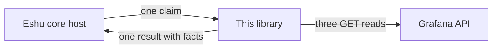
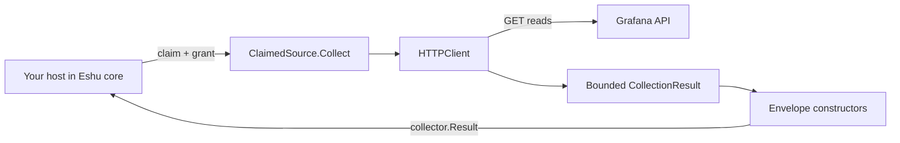
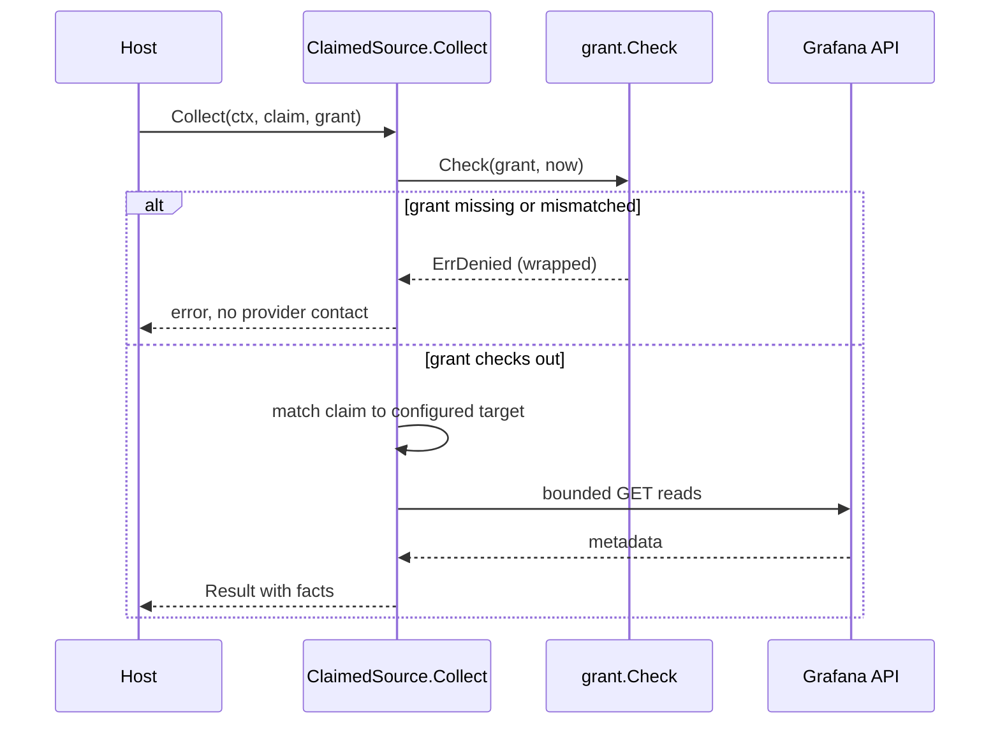

# Diagrams

Every diagram for this library lives on this page, each with a caption and a plain-text version. Other pages link here instead of repeating the picture. The root README keeps the first one only.

## The whole exchange, at a glance

Caption: an Eshu core host hands this library one claim (one bounded work request); the library makes three GET reads against the Grafana API and returns one result full of facts.

Text version: host → claim → library → three GET reads → Grafana API → metadata → library → one result with facts → host. Nothing here runs on its own schedule.

## The trip a claim takes

Caption: inside one `Collect` call — the grant is checked, the claim is matched to a configured target, bounded metadata is fetched through `HTTPClient`, and envelope constructors wrap it as a `collector.Result`.

Text version: your host hands over a claim and a grant, the library checks the grant, picks the target the claim names, fetches bounded metadata, wraps it as facts, and returns one result. If Grafana misbehaves, you get a classified failure instead, and you decide what happens next.

## The grant check, up close

Caption: sequence of the grant check. It happens first and can stop everything: a missing or mismatched grant ends the call before any provider contact.

Text version, step by step: the host calls `Collect`, `Collect` asks `grant.Check` to validate the grant, and a bad grant ends the call right there. Only a good grant leads to target matching and Grafana reads. A good read comes back as a result full of facts.
